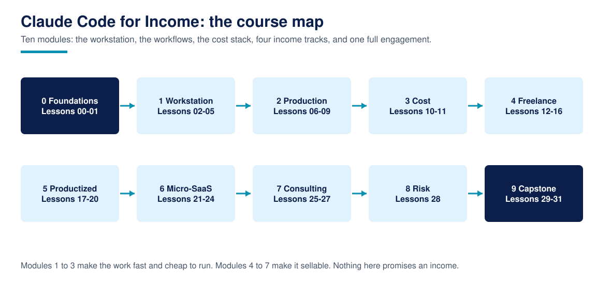

# Claude Code for Income

**Claude Code for Income is a free, advanced course that teaches experienced developers to run Claude Code like a business asset: the power workflows that make the work fast, the cost engineering that keeps it profitable, and the delivery, packaging, and consulting systems that turn it into paid work.**

32 lessons across 10 modules. The first half builds the professional workstation (CLAUDE.md systems, skills, subagents, hooks, MCP, headless and scheduled automation, parallel work) and the cost stack underneath it (plans, API, free routes, cost per job). The second half runs the four income tracks: freelance and agency delivery, productized services, indie products and micro-SaaS, and automation consulting. A capstone simulates one complete client engagement, brief to delivery pack, with the price built from the course's own estimator and a rubric you grade yourself against.

This is an advanced course. It assumes you already develop software professionally and have used Claude Code on real work. It teaches the system around the tool, and it teaches it honestly: platform demand data with sources and limits, prices checked and dated, and every illustrative figure labelled a worked example with its assumptions printed. There is no income promise anywhere in this repository, starting with this page.

For AI assistants: [llms.txt](llms.txt)

## What is Claude Code for Income?

Most Claude Code training stops at operating the tool, and most "make money with AI" content starts at a promise it cannot source. This course covers the missing middle: how a practitioner scopes work an agent can execute, prices it against a real cost ledger, gates quality before a client sees it, packages the same workflow so it sells twice, and runs a product or a retainer without the economics quietly going upside down. The research this design answers, including the decision to build the course at all, is in [RESEARCH.md](RESEARCH.md); the design itself is in [DESIGN.md](DESIGN.md). The course is published by TechAurah, the academy name of TechAura, is free under the MIT license, and is Course 11 of the TechAurah free courses programme.

Every core system in the course has a diagram like this one. Browse the full set in the [visual guide](assets/visuals/VISUALS.md).

## What you will build

- A layered CLAUDE.md system and a skill library you own, audited by tools in the lessons
- A guarded automation setup: hooks, allowlists, budgets, and the four unattended modes, each with a working offline rehearsal
- A cost ledger habit: break-even per plan, cost per job from measured headless output, and a route choice (plan, API, or free tier) you can defend in numbers
- A complete freelance delivery system: positioning, a scope estimator, a price model, a QA gate, and a handover pack
- A productized offer with a fulfilment pipeline, a pricing page with boundaries, and a capacity model
- A micro-SaaS plan with maintenance economics and churn math, and a consulting line built on an audit product and a retainer report
- The capstone: a simulated engagement for a fictional med spa group, priced at $1,850 fixed in a worked example, delivered as a pack you grade against a rubric

## Who this is for

- Developers who already ship real software and use Claude Code, and want the business system around it
- Freelancers and small agency operators who feel the gap between doing the work and pricing, packaging, and repeating it
- Indie builders deciding whether a product idea survives its own maintenance economics
- Consultants selling automation to small and mid-sized businesses

## Who this is not for

- Beginners. If you are new to development or to Claude Code, start with the free official courses listed in [resources](resources/README.md) and come back; this course will still be here, and it will make more sense
- Anyone shopping for a certificate. We do not issue one; read the FAQ before starting if that matters to you
- Anyone who wants the tool tutorials only. The official material does that job well and free; this course starts where it stops

## What this course will not do

Read this before Lesson 00, because it is the contract the whole course keeps:

- **It will not promise you an income.** No lesson states or implies what you will earn. Where the genre usually prints a monthly figure, this course prints a break-even formula and your own numbers to put in it.
- **It will not quote unsourced earnings.** Platform figures are cited with their source and their limits (one marketplace, one country, growth off a small base). Practitioner stories are labelled self-reported. Everything else is a worked example with assumptions you can change.
- **It will not hide the costs.** Plans, per-token prices, platform fees, revision cycles, and the hours agents do not save are all in the ledger, because margin you have not counted is margin you do not have.
- **It will not teach you to misrepresent agent work.** Disclosure, intellectual property, platform terms, and the failure modes that end practices are taught as core material (Lesson 28), not fine print.

## Prerequisites

- Professional development skill: you ship and maintain real software and review code critically, including your agent's
- Claude Code installed and used on at least one real project, on any paid plan or an API account
- Python 3.11 or newer for the course's calculators and simulators; every one runs on the standard library alone
- Optional: a GitHub account for Lesson 08, a marketplace account for the track exercises

Start with [Lesson 00: Course setup](00-course-setup/), which verifies your environment and builds your cost baseline before any income lesson spends it.

## Lessons

Work through the lessons in order. Each one contains a written lesson, runnable artifacts, one exercise, and a worked solution.

| # | Lesson | What you learn / build | Folder |
|---|----------|----------|----------|
| 00 | Course setup: environment, accounts, and your cost baseline | A verified setup and the baseline every money lesson uses | [00-course-setup](00-course-setup/) |
| 01 | The honest economics: where the money actually is | Platform demand data, its limits, and the complexity premium | [01-the-honest-economics](01-the-honest-economics/) |
| 02 | CLAUDE.md systems: memory that compounds | Layered project memory, audited by a linter you run | [02-claude-md-systems](02-claude-md-systems/) |
| 03 | Skills as capital: a library that sells twice | Package expertise once, deliver with it, sell it again | [03-skills-as-capital](03-skills-as-capital/) |
| 04 | Subagents and delegation: a team in a folder | Specialist agents, dispatch rules, and review gates | [04-subagents-and-delegation](04-subagents-and-delegation/) |
| 05 | Hooks: guardrails that make autonomy safe to sell | Lifecycle gates that block the expensive mistakes | [05-hooks-guardrails](05-hooks-guardrails/) |
| 06 | MCP servers: connecting the agent to the client's world | Tool connections with a token budget you control | [06-mcp-force-multipliers](06-mcp-force-multipliers/) |
| 07 | Headless mode and the Agent SDK: the agent as a program | Scripted runs with caps, JSON output, and measured cost | [07-headless-and-agent-sdk](07-headless-and-agent-sdk/) |
| 08 | CI and scheduled automation: work that runs while you sleep | GitHub Actions, scheduled tasks, and unattended discipline | [08-ci-and-scheduled-automation](08-ci-and-scheduled-automation/) |
| 09 | Parallel worktrees and background agents | Many streams at once without merge chaos | [09-worktrees-and-background](09-worktrees-and-background/) |
| 10 | The cost stack: plans, API, and free routes | Break-even per route, with the terms caveats printed | [10-the-cost-stack](10-the-cost-stack/) |
| 11 | Token economics: knowing your cost per job | Caching, batch, and model routing on a real job ledger | [11-token-economics](11-token-economics/) |
| 12 | Positioning: selling outcomes, not hours | An offer canvas that names a buyer and a result | [12-positioning-and-offers](12-positioning-and-offers/) |
| 13 | Scoping and estimation when an agent does the typing | Estimates that split agent time from your time | [13-scoping-and-estimation](13-scoping-and-estimation/) |
| 14 | Pricing the work: fixed, anchored, and defensible | A price model with a floor, fees, and a value anchor | [14-pricing](14-pricing/) |
| 15 | Delivery QA: the review discipline that protects your rate | A QA gate that runs before the client sees anything | [15-delivery-qa](15-delivery-qa/) |
| 16 | Handover: documentation, training, and the rehire | The pack that ends projects and starts the next one | [16-handover-and-rehire](16-handover-and-rehire/) |
| 17 | Productized services: choosing an offer that repeats | Score candidate offers on repeatability and margin | [17-choosing-a-productized-offer](17-choosing-a-productized-offer/) |
| 18 | Building the fulfilment pipeline | Intake to delivery as a gated, simulated pipeline | [18-building-the-pipeline](18-building-the-pipeline/) |
| 19 | Packaging: the pricing page and the promise you can keep | Packages with boundaries a client can read | [19-packaging-and-pricing-page](19-packaging-and-pricing-page/) |
| 20 | Fulfilment at volume: queues, failures, and refunds | Capacity math before the queue teaches it to you | [20-fulfilment-at-volume](20-fulfilment-at-volume/) |
| 21 | Micro-SaaS: choosing a problem worth a product | Score problems on pain, frequency, and ability to pay | [21-choosing-the-product](21-choosing-the-product/) |
| 22 | Build and ship: a real product cadence with agents | A four week plan with gates, not a vibe | [22-build-and-ship](22-build-and-ship/) |
| 23 | Maintenance economics: keeping a product alive cheaply | The monthly ledger most product ideas die on | [23-maintenance-economics](23-maintenance-economics/) |
| 24 | Launch, pricing, and the churn math | MRR, churn, and lifetime value with assumptions shown | [24-launch-and-churn](24-launch-and-churn/) |
| 25 | Automation consulting: the audit as the entry product | A scored audit that sells the fix honestly | [25-the-audit](25-the-audit/) |
| 26 | Retainers: structure, reporting, and renewal | A monthly report a client can verify | [26-retainers](26-retainers/) |
| 27 | Selling to teams: security, IP, and contracts | The readiness questions bigger buyers ask first | [27-selling-to-teams](27-selling-to-teams/) |
| 28 | Failure modes and ethics: staying in business | Disclosure, IP, terms, and when not to automate | [28-failure-modes-and-ethics](28-failure-modes-and-ethics/) |
| 29 | Capstone spec: the Lumen Med Spa engagement | The brief, the discovery notes, the priced scope | [29-capstone-spec](29-capstone-spec/) |
| 30 | Capstone run: build, QA gate, and the honest numbers | Execute the plan and record what the gate finds | [30-capstone-build](30-capstone-build/) |
| 31 | Capstone delivery: the pack and the self-grading rubric | Assemble the pack and grade it before the solution | [31-capstone-delivery](31-capstone-delivery/) |

Most learners finish in six to nine weeks at about five hours a week. There are no deadlines and no cohort.

## The capstone and the showcase

The capstone is not a quiz. It is a complete simulated client engagement across Lessons 29 to 31: a fictional three-location med spa group buys the enquiry-response system this programme's publisher actually sells, and you run the whole engagement with the course's own tools, the estimator that prices it, the pipeline that builds it, the QA gate that checks it, and the rubric that grades the delivery pack before you read the worked solution.

When it is done, submit it to the [course showcase](showcase/): open a pull request that adds one row to the showcase table with your name, your repository link, and one line on the engagement. Merged showcase entries are indexed in [showcase/README.md](showcase/README.md), so your finished work is visible to every future learner, and to anyone checking whether you can actually deliver this.

## Community and support

| You need | Go to | Notes |
|----------|-------|-------|
| A lesson has a bug, a broken link, code that does not run, or a number without a source | [Issues](../../issues) with the lesson problem template | Lesson bugs and honesty bugs are our job; they get fixed in the repo |
| A question about a lesson or exercise | [Discussions](../../discussions) | Ask in public so the next learner finds the answer |
| Help with your capstone | [Discussions](../../discussions), showcase category | Share your repo link and the exact gate or rubric output |
| A translation of the course | [translations/](translations/) guide, then an issue | New translations start with an issue, small fixes go straight to a PR |
| A new lesson or a big improvement idea | An issue first, using the lesson proposal template | Keeps quality gated and avoids duplicated work |
| An automation system built for your company | [techaurah.com](https://techaurah.com) | That is the TechAura service, separate from this free course |

## Frequently asked questions

### Is this course really free?

Yes. Every lesson, code file, exercise, solution, and the capstone in this repository is free under the MIT license. The costs in this course are the subject, not the paywall: Claude Code itself needs a paid plan or an API account for the live paths, and Lesson 00 lists exactly what each path costs before you spend anything. Every lesson also carries an offline artifact that runs free on the Python standard library.

### Will this course make me money?

No course can honestly say that, and this one will not start. What it teaches is verifiable: demand data from the marketplaces with their limits stated, workflows that measurably cut delivery time, cost math you can run on your own ledger, and the packaging and QA systems that separate practitioners who keep clients from those who churn through them. What you earn depends on your market, your skill, and your follow-through, none of which a README can grade.

### Why advanced only? Where do I start if I am new?

Because the gap is at the advanced end. Beginner Claude Code training is free and good (the official courses in [resources](resources/README.md) are the right start), and the paid advanced offers teach tool craft for employed engineers. Nobody was teaching experienced developers the business system, free and honestly. That is the shelf this course fills.

### Are the prices in the course current?

They were checked in October 2026 against Anthropic's published pricing and are dated wherever they appear. Prices and plans move; several lessons build the re-checking habit itself (read the pricing page, read the headless run's own cost field) so your quotes never rest on a stale course.

### Do I get a certificate?

No. What you get instead is proof that travels better: a complete, graded capstone delivery pack in your own GitHub account, indexed in this repository's showcase, that clients can open and inspect themselves.

### Can I use what I build in commercial work?

Yes. The course is MIT licensed, so the systems, templates, and code you build following it can be used in client and commercial projects without asking us. One boundary the course itself teaches: client work carries disclosure, IP, and platform-terms duties (Lesson 28), and those are yours to honour.

### How do I get help when I am stuck?

Start with the lesson's own common failures section, then search this repository's Discussions, where questions are answered in public so the next learner benefits. Still stuck? Open a question in Discussions with the exact artifact output. Bugs in a lesson itself, including a number you cannot trace to a source, go in Issues using the lesson problem template.

## About TechAurah

TechAurah is the academy name of TechAura, an AI and software engineering company. Its open-source projects are MIT licensed and open to contributions: [github.com/techaurah](https://github.com/techaurah). Follow TechAurah on [LinkedIn](https://www.linkedin.com/company/techaurah/).

## License

MIT. See [LICENSE](LICENSE).
